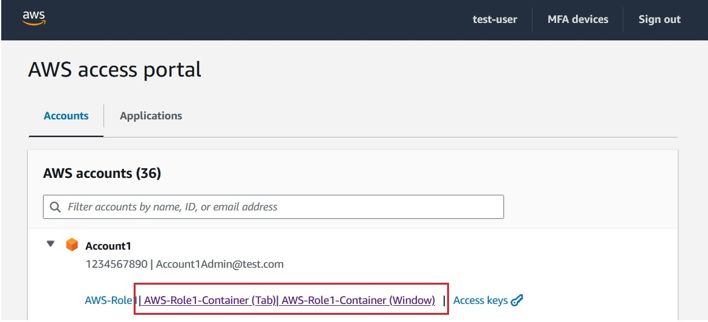
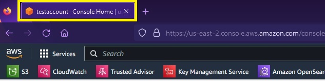
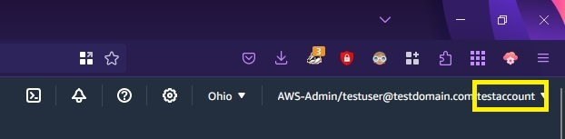
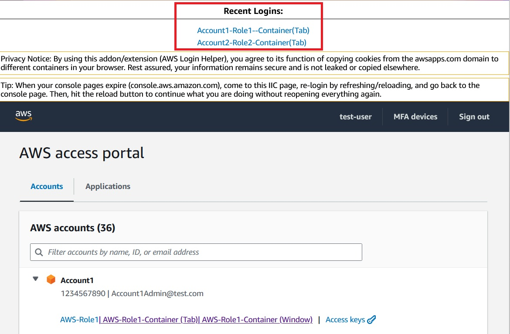
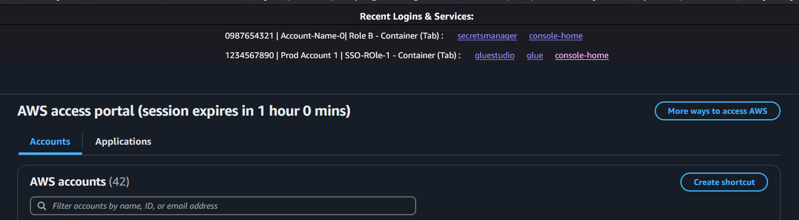
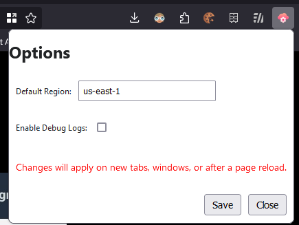
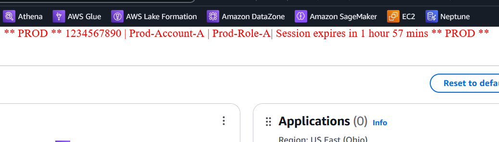
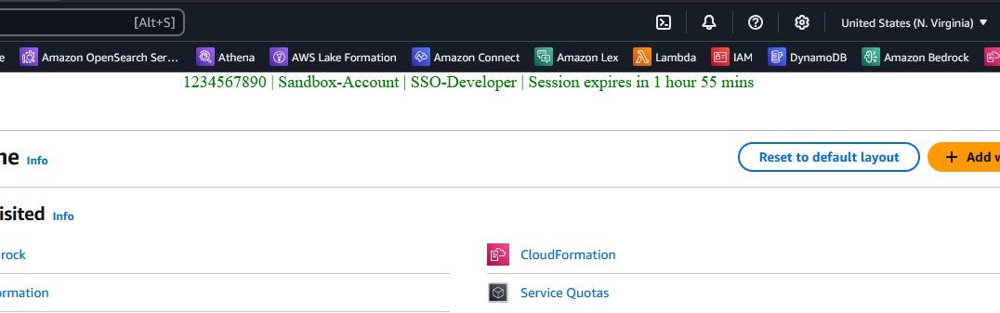

# AWS Login Helper

AWS Login Helper is a Firefox extension designed to enhance your login experience with AWS (Amazon Web Services).

Say goodbye to repetitive logins! Simply log in once to the AWS IAM Identity Center (IIC), and then access the Management Console of any account for which you have permission using Firefox containers in a new tab or window.

**DISABLE OTHER AWS SSO/IIC Container Extensions for this extension to work properly**

This extension adds two new links for each of your roles: one for a container tab and another for a container window. When clicked, the selected account/role will open in a new container tab or window. Containers are automatically created using the account number, account name, and role name.

## Privacy & Security

We take the privacy and security of our users very seriously. This extension does not store or leak any information. All the code is open source, and you can verify it yourself.

---

## Inspiration

This project is inspired by [cookie-quick-manager](https://github.com/ysard/cookie-quick-manager/).

---

## Installation

You can install the AWS Login Helper extension from the official Firefox Add-ons website:

[Install AWS Login Helper](https://addons.mozilla.org/en-US/firefox/addon/aws-login-helper/)

---

## Features

The extension offers several features to streamline your AWS Console experience:

1. **Authenticate Once, Sign into Multiple Accounts**

    AWS Login Helper simplifies the login process by enabling you to authenticate once. After signing in using AWS IAM Identity Center (IIC), the extension allows you to log into different accounts using Firefox containers without repeatedly entering credentials. You can open the account you want to log in to in a new tab or window **using the additional links added by the extension**.

    

2. **Tab/Window Title Updates**

    The extension updates the title of your Firefox tabs or windows to display the name of the currently active AWS account. This makes it easier to identify and manage your AWS sessions, especially when you have multiple AWS accounts open simultaneously.

    

3. **Additional Info**

    AWS Login Helper enhances the AWS Management Console by adding the account ID, name, role, and session time. This feature simplifies navigation and ensures that you're always aware of the AWS account you're working in.

    

4. **Recent Login History**

    The Recent Login History feature showcases the five most recent role logins directly on the IIC login page. This saves time and effort by eliminating the need to search for recent roles manually.

    

    

5. **Open Console Pages in Your Region by Default**

    Automatically open all your console pages in the region set in the options window.
    
    

6. **Color-Coded Banner by Environment**

    Display a color-coded banner at the top of the console page to easily identify the account, role, and environment you're working in.

    

    

---

## Supported AWS Services

AWS Login Helper is designed to work seamlessly with AWS IAM Identity Center (IIC) for a streamlined login experience. Please note that it does not currently support AWS Single Sign-On (SSO).

---

## Known Issues

- You may lose the link to open an account/role in a new tab or window when you collapse and expand the account. We are actively working on a solution for this issue.

---

## Future Enhancements

---

## Link to GitHub Repository

[GitHub Repository](https://github.com/penchala-services-inc/aws-login-helper-firefox)

---

## Feedback and Contributions

We welcome your feedback and contributions to improve AWS Login Helper. If you encounter any issues, have ideas for enhancements, or want to contribute to the development, please visit our GitHub repository.

---

## License

This project is licensed under [GPLv3](./LICENSE).

---

## Icons by

<a href="https://www.flaticon.com/free-icons/saas" title="saas icons">Saas icons created by Freepik - Flaticon</a>

